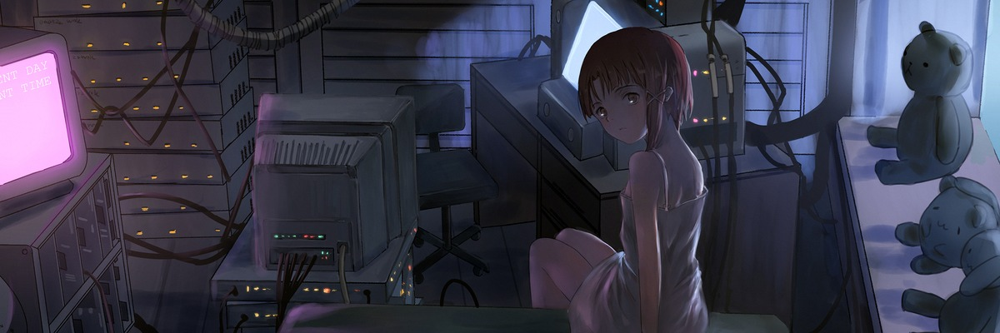

<div align="center">
  
  <br /><br />
  <sub><code>present day, present time.</code></sub>
</div>

```text
nojin@wired ~ $ cat /etc/identity
alias     :: nojin
node      :: jakarta, id (utc+7)
os        :: nixos 26.05 / niri / ghostty
focus     :: full-stack web, terminal ui, pixel-art renderers
```

I write web applications, backend services, and small terminal programs. Most of my time goes into TypeScript, Rust, Next.js, Astro, and Laravel, running on a declarative NixOS setup.

### index

- **[komo](https://github.com/NojinNojs/komo)** — terminal virtual pet and habitat in Rust (`ratatui`, 40x22 half-block truecolor canvas)
- **[karsa-bot](https://github.com/NojinNojs/karsa-bot)** — night-market coffee stall economy bot for Discord (`bun`, `typescript`, `sqlite wal`, custom 16-bit canvas renderer)
- **[eve-ded-tracker](https://github.com/NojinNojs/eve-ded-tracker)** — escalation ledger and profit tracker for EVE Online (`next.js`, `supabase`, `tailwind v4`)
- **[mellblue](https://github.com/NojinNojs/mellblue)** — full-stack storefront with order timelines and pdf receipts (`laravel 12`, `react 19`, `inertia`)
- **[toko-sparepart](https://github.com/NojinNojs/toko-sparepart)** — automotive parts catalog and admin panel (`laravel 12`, `blade`, `gd image pipeline`)
- **[lyrics-transcriber](https://github.com/NojinNojs/lyrics-transcriber)** — word-level timestamped lyric transcription cli (`python`, `whisper`)

### stack

```text
lang      :: typescript, rust, php, python, sql
web       :: next.js, astro, react, tailwind css, gsap
backend   :: bun, laravel, node.js, hono, postgresql, sqlite
system    :: nixos, docker, linux, git
```

<div align="center">
  <sub><code>close the world. open the next.</code></sub>
</div>
