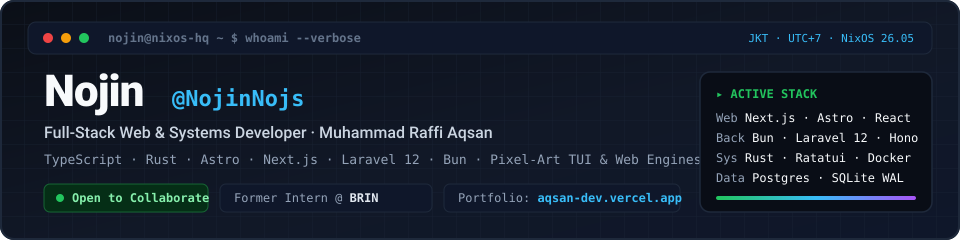

  

 

  
  
  
  

---

## 👋 Hey, I'm **Nojin**

I'm **Nojin** (*Muhammad Raffi Aqsan*) — a Full-Stack Web & Systems Developer based in **Jakarta, Indonesia**.

I build fast, tactile web applications, production backends, and pixel-accurate terminal/canvas tools. My work spans modern frontend architecture (**Astro**, **Next.js**, **React**, **GSAP**), full-stack commerce & internal dashboards (**Laravel 12**, **Bun**, **TypeScript**, **PostgreSQL**, **SQLite WAL**), and low-overhead systems software in **Rust** running on **NixOS**. Previously, I completed a 6-month hands-on software & IT engineering internship at **BRIN** (*Badan Riset dan Inovasi Nasional*).

---

## 🚀 Featured Engineering Projects

<table>
  <tr>
    <td width="50%" valign="top">
      <h3>🌿 <a href="https://github.com/NojinNojs/komo">KOMO</a></h3>
      
<strong>Living Terminal Companion &amp; 40×22 TrueColor Pixel-Art TUI in Rust</strong>

      
A zero-bloat terminal habitat built with Rust and Ratatui. Renders a 40×22 half-block TrueColor canvas with a 6-species evolution engine, autonomous daily schedules, deterministic pixel-art PNG card exporter (<code>--share</code>), and atomic JSON persistence.

      

        
        
        
      

    </td>
    <td width="50%" valign="top">
      <h3>☕ <a href="https://github.com/NojinNojs/karsa-bot">KARSA</a></h3>
      
<strong>Night-Market Coffee Stall &amp; Cooperative Economy Discord Bot</strong>

      
A Dockerized multiplayer economic simulation bot built on Bun, TypeScript, and SQLite WAL ACID transactions. Features a custom deterministic 16-bit pixel-art card renderer (<code>@napi-rs/canvas</code> at 384×216 upscaled 3× nearest-neighbor) and bilingual ID/EN support.

      

        
        
        
      

    </td>
  </tr>
  <tr>
    <td width="50%" valign="top">
      <h3>⚡ <a href="https://github.com/NojinNojs/aqsan-dev">aqsan-dev</a></h3>
      
<strong>Motion-Driven Personal Engineering Portfolio</strong> · <a href="https://aqsan-dev.vercel.app">Live Site ↗</a>

      
Personal portfolio and engineering showcase built with Astro 5, GSAP 3.15, Lenis smooth momentum scrolling, and strict TypeScript. Designed for near-instant static delivery, choreographed scroll interactions, and full Schema.org metadata.

      

        
        
        
      

    </td>
    <td width="50%" valign="top">
      <h3>🍰 <a href="https://github.com/NojinNojs/mellblue">MELLBLUE</a></h3>
      
<strong>Full-Stack Artisan Food E-Commerce Platform</strong>

      
End-to-end commerce platform built with Laravel 12, React 19, Inertia.js, and Tailwind CSS v4. Covers catalog variants, checkout, payment proof verification, real-time order status timelines, admin analytics, and automated DomPDF invoice generation.

      

        
        
        
      

    </td>
  </tr>
  <tr>
    <td width="50%" valign="top">
      <h3>🚀 <a href="https://github.com/NojinNojs/eve-ded-tracker">EVE DED Tracker</a></h3>
      
<strong>Combat Ledger &amp; PnL Analytics Web App</strong> · <a href="https://eve-ded-tracker.vercel.app">Live Site ↗</a>

      
Full-stack profit/loss tracker and escalation farming analytics app for EVE Online players. Built with Next.js 16 (App Router), React 19, Bun, Tailwind CSS v4, and Supabase authentication with bilingual EN/ID switching.

      

        
        
        
      

    </td>
    <td width="50%" valign="top">
      <h3>🛠️ <a href="https://github.com/NojinNojs/toko-sparepart">Toko Sparepart Otomotif</a> &amp; <a href="https://github.com/NojinNojs/brin-client-count">BRIN Dashboard</a></h3>
      
<strong>Production E-Commerce &amp; Institutional Telemetry</strong>

      
Automotive spare parts e-commerce with client-side Cropper.js + server-side PHP GD image optimization in Laravel 12, alongside a real-time visitor &amp; session monitoring dashboard built in Next.js during my internship at BRIN.

      

        
        
        
      

    </td>
  </tr>
</table>

---

## 🛠️ Tech Stack & Daily Environment

- **Languages:** TypeScript, JavaScript (ES2024+), Rust, PHP 8.3+, Python, SQL, HTML5/CSS3
- **Frontend & Motion:** Next.js (App Router), Astro 5, React 19, Tailwind CSS v4, shadcn/ui, GSAP, Lenis
- **Backend & Runtime:** Bun, Node.js, Laravel 12, Hono, Express, Hapi, Inertia.js, REST APIs
- **Data & Infrastructure:** PostgreSQL, MySQL/MariaDB, SQLite (WAL), Supabase, Docker, NixOS, Linux, Vercel, Cloudflare

  
  
  
  
  
  
  
  
  
  
  
  

---

## 📊 GitHub Activity & Telemetry

  
  

  

