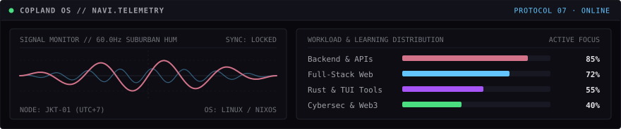

<div align="center">
  
  <br />
  <sub><code>present day, present time.</code></sub>
</div>

<br />


### hey, i'm nojin.

I'm a software developer from Jakarta. I like exploring different parts of software engineering (frontend, full-stack, and terminal tools), though I naturally spend most of my time on **backend development**.

I don't really have one favorite tech stack; I just pick up whatever fits the problem. Ever since moving to **Linux / NixOS**, I've been drawn to **Rust** and systems programming, so I'm currently learning it from the ground up alongside **cybersecurity**, **blockchain**, and **Web3**.

Outside of code, I spend a lot of time reading, especially **Fyodor Dostoevsky** and **Pramoedya Ananta Toer**.

<br clear="right" />

```ini
# nojin@nixos ~ $ cat /etc/nojin.conf
[node]
alias       = "Nojin"
system      = "Linux / NixOS"
usual_kit   = ["TypeScript", "PHP / Laravel", "Next.js", "Astro", "Bun", "PostgreSQL", "SQLite"]
learning    = ["Rust (from scratch)", "Cybersecurity", "Blockchain & Web3", "TUI"]
reading     = ["Dostoevsky", "Pramoedya Ananta Toer"]
```

---

### projects

<table width="100%" border="0" cellspacing="0" cellpadding="0">
  <tr>
    <td width="50%" align="center" valign="top">
      <a href="https://github.com/NojinNojs/komo"></a>
    </td>
    <td width="50%" align="center" valign="top">
      <a href="https://github.com/NojinNojs/karsa-bot"></a>
    </td>
  </tr>
  <tr>
    <td width="50%" align="center" valign="top">
      <a href="https://github.com/NojinNojs/eve-ded-tracker"></a>
    </td>
    <td width="50%" align="center" valign="top">
      <a href="https://github.com/NojinNojs/mellblue"></a>
    </td>
  </tr>
</table>

<details>
  <summary><code>▸ ls /wired/more-projects (4)</code></summary>
  <br />

  - **[toko-sparepart](https://github.com/NojinNojs/toko-sparepart)** (`Laravel`, `Tailwind`) : Auto parts catalog and admin dashboard with server-side GD image processing.
  - **[tobuk-app](https://github.com/NojinNojs/tobuk-app)** (`Laravel`, `React`) : Online bookstore and inventory management app.
  - **[moment](https://github.com/NojinNojs/moment)** (`TypeScript`, `React`) : Personal finance and multi-account expense tracker.
  - **[lyrics-transcriber](https://github.com/NojinNojs/lyrics-transcriber)** (`Python`, `Whisper`) : CLI tool that generates word-by-word timed lyrics from audio files.
</details>

---

### telemetry

<div align="center">
  
  <br /><br />
  <a href="https://github.com/NojinNojs">
    
    
  </a>
  <br /><br />
  <a href="https://github.com/NojinNojs">
    
  </a>
</div>

<br />

<div align="center">
  
  <br />
  <sub><i>no matter where you go, everyone's connected.</i></sub>
</div>
